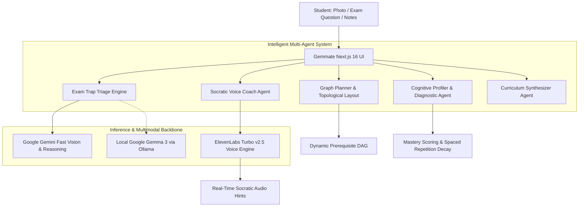

# 💎 Gemmate: Autonomous Socratic Voice Companion & Dynamic Knowledge DAG

<div align="center">
  
  <br />
  <h3>Autonomous AI study partner that turns exam traps and study notes into an interactive, living prerequisite Knowledge DAG with Socratic voice coaching.</h3>
  <p>
    <a href="https://gemmate.inusha.me"><strong>🌐 Live Demo: gemmate.inusha.me</strong></a> &bull;
    <a href="https://github.com/inusha-thathsara/Gemmate"><strong>📦 GitHub Repository</strong></a>
  </p>
</div>

---

## 📖 The Problem

For students preparing for rigorous technical exams, deceptive questions frequently trigger acute exam anxiety:

- **Deceptive Edge Cases**: Subtly contradictory boundary constraints, unit tricks, or counter-intuitive assumptions.
- **Cognitive Blindspots**: Believing a concept is understood until an exam problem combines it with subtle prerequisite invariants.
- **Passive AI Crutches**: Pasting problems into standard chatbots dumps walls of final answers, robbing students of the opportunity to develop true analytical deconstruction skills.

**Gemmate** solves this with an **adaptive, 100% user-input-driven architecture**: rather than spoon-feeding solutions, Gemmate deconstructs deceptive exam questions into an **actionable Attack Plan**, weaves discovered prerequisites into a **living Knowledge DAG**, and uses **ElevenLabs Socratic Voice hints** to guide active recall.

---

## ✨ Key Capabilities

### 1. ⚡ Exam Trap Triage

- **Dual-Input Modality**: Upload photos of printed exams, handwritten equations, or type/paste markdown questions directly.
- **Trap Deconstruction**: Identifies the exact cognitive trick (_The Trap_), extracts foundational _Core Concepts_, and generates a 4-step _Attack Plan_.
- **Live DAG Weaving**: Automatically links triaged questions to the user's Dynamic Knowledge DAG, creating structured prerequisite and challenge nodes.

### 2. 🕸️ Dynamic Knowledge DAG

- **100% Input-Driven**: No hardcoded or fake courses. The graph starts pristine and grows organically around your uploaded past papers, lecture notes, and triaged problems.
- **Topological Visual Graph**: Interactive node-link diagram showing prerequisite chains, unlocking mechanisms, and mastery progression.
- **Remedial Bridge Nodes**: When a student demonstrates a foundational gap, the Cognitive Profiler automatically splices remedial bridge modules into the DAG.

### 3. 🎙️ Socratic Studio & Voice Coach

- **Progressive Hint Ladder**: 3 tiers of guidance (Foundational Nudge → Structural Invariant → Concrete Strategy) that prompt self-correction without spoiling the answer.
- **ElevenLabs Voice AI**: Comforting, pedagogical voice playback with real-time waveform audio visualization.
- **Adaptive Analogies**: Contextualizes difficult concepts using analogies tailored to the learner's chosen background (e.g., Software Engineering, Gaming, Architecture).

### 4. 🎯 Trap Vulnerability Matrix & Retention Radar

- **Cognitive Categorization**: Groups traps into _Boundary Slips_, _Contradictory Constraints_, _Worst-Case Fallacies_, and _Formula Misapplications_.
- **Ebbinghaus Spaced Repetition**: Simulates memory retention decay ($R = e^{-\Delta t / S}$). Mastered nodes decay over time without review, triggering visual review alerts.

### 5. 📝 Notes-to-Curriculum Synthesizer

- **Course Notes Upload**: Paste raw lecture notes or textbook chapters to instantly synthesize a multi-tier prerequisite skill graph.
- **Instant Targeted Drills**: Generates isomorphic practice drill problems with automated rubrics and mastery tracking.

---

## 🛠️ Architecture & Tech Stack



- **Frontend & App Router**: Next.js 16 (App Router, Turbopack), React 19, Tailwind CSS, Framer Motion
- **AI Models & Agents**:
  - Google Gemini (`gemini-3.1-flash-lite-preview`, `gemini-3-flash-preview` with hedged racing for sub-6s multimodal analysis)
  - Google Gemma 3 (`gemma3:1b` via local Ollama for 100% private, offline inference)
- **Voice Intelligence**: ElevenLabs Text-to-Speech API (`eleven_turbo_v2_5`) with streaming and audio caching
- **Typography & Math**: KaTeX rendering for complex mathematical expressions and formulas

---

## 🚀 Getting Started

### 1. Prerequisites

- [Node.js](https://nodejs.org) (v20+ recommended)
- [Google AI Studio API Key](https://aistudio.google.com) (free)
- [ElevenLabs API Key](https://elevenlabs.io) (for voice playback)
- _(Optional)_ [Ollama](https://ollama.com) with `ollama pull gemma3:1b` for local offline reasoning.

### 2. Installation

```bash
# Clone the repository
git clone https://github.com/inusha-thathsara/Gemmate.git
cd Gemmate

# Install dependencies
npm install
```

### 3. Configure Environment

Copy `.env.example` to `.env.local`:

```bash
cp .env.example .env.local
```

Fill in your API keys in `.env.local`:

```env
GEMINI_API_KEY=your_gemini_api_key_here
ELEVENLABS_API_KEY=your_elevenlabs_api_key_here
ELEVENLABS_VOICE_ID=21m00Tcm4TlvDq8ikWAM
```

### 4. Run Development Server

```bash
npm run dev
```

Open [http://localhost:3000](http://localhost:3000) to start using Gemmate!

### 5. Production Build Verification

```bash
npm run build
npm run start
```

---

## 📄 License

Distributed under the MIT License.
